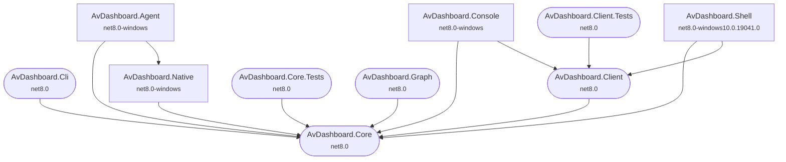
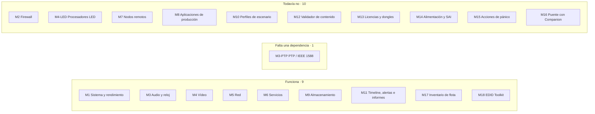

# Mapa del proyecto

> Generado por `tools/AvDashboard.Graph` desde el propio código. **No lo edites a
> mano**: el gancho de commit lo regenera y el CI comprueba que coincide.
>
> Un diagrama dibujado a mano miente a las dos semanas. Este no puede.

## Proyectos y dependencias

Los proyectos redondeados son multiplataforma y el CI los prueba en Linux. Los
rectangulares dependen de Windows: COM, P/Invoke y WPF.

## Módulos

## Catálogo de ajustes (M1)

| Grupo | Ajustes | Con objetivo | Impacto alto | Fuera de los perfiles |
|---|---:|---:|---:|---:|
| Energía | 13 | 13 | 8 | 0 |
| Kernel y rendimiento | 14 | 11 | 8 | 2 |
| Interrupciones y actualizaciones | 11 | 11 | 8 | 0 |
| Seguridad | 3 | 1 | 1 | 0 |
| Arranque y sesión | 4 | 4 | 3 | 0 |
| Adaptador de red | 3 | 3 | 2 | 0 |
| Diagnóstico | 4 | 0 | 0 | 0 |
| **Total** | **52** | **43** | **30** | **2** |

«Fuera de los perfiles» son los que nunca entran en un cambio automático porque
tocarlos reduce la seguridad de la máquina de forma real.

## Superficie

- **27 comandos** de CLI y paleta.
- **24 actuadores** declarados, de los cuales 10 pueden interrumpir una salida en directo.

### Comandos por sector

| Sector | Comandos |
|---|---|
| Audio | `audio`, `ptp` |
| Video | `edid-check`, `edid-diff`, `edid-dump`, `edid-info`, `edid-list`, `edid-ref`, `gpu-reset`, `monitors` |
| Network | `latency`, `netinfo`, `portcheck`, `scan`, `setip` |
| Production | `panic`, `preshow`, `profile`, `services`, `timeline` |
| SystemEssential | `audit`, `profile-export`, `profile-import`, `profiles`, `sysinfo`, `tele` |
| Storage | `disks` |

